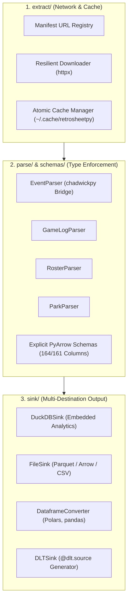

# Architecture & Design Philosophy

`retrosheetpy` is engineered around four core tenets: **zero compiler requirements**, **strict schema typing**, **pipeline decoupling**, and **respect for Retrosheet server resources**.

---

## Decoupled Pipeline Architecture

Each stage of the data pipeline is isolated in its own package with clean contracts:

### 1. `extract/` (Network & Caching)
* **`manifest.py`**: Resolves canonical Retrosheet HTTP endpoints (e.g. `https://www.retrosheet.org/events/2024eve.zip`, with automated fallback to `{year}seve.zip` for older archive conventions).
* **`cache.py`**: Manages atomic downloads, extracted archive trees, and cache eviction under `~/.cache/retrosheetpy/` (configurable via `RETROSHEETPY_CACHE_DIR`).
* **`downloader.py`**: Handles retries, HTTP status verification, and decompression safely.

### 2. `schemas/` & `parse/` (Strict Typing)
* **No `VARCHAR`-only Dumps**: In many tools, raw files are loaded with everything as strings. `retrosheetpy` provides strict schemas:
  * Game dates are parsed to `date32()`.
  * Outs, innings, balls, strikes, and base states are parsed to `int16()` or `int32()`.
  * Flags (`HR_FL`, `RBI_FL`, `SH_FL`, `SF_FL`, etc.) are parsed to `bool_()`.
* **Chadwick Integration**: Uses pure Python `chadwickpy` wheels to process Retrosheet event files without subprocesses or C tool binaries.

### 3. `sink/` (Pluggable Output Writers)
* The parsers emit standard **PyArrow Tables** or record iterators.
* Sinks write directly into:
  * **DuckDB**: Fast in-memory or persisted SQL engine with automatic column alignment.
  * **Parquet / Arrow**: Snappy-compressed columnar formats.
  * **Polars & pandas**: In-memory DataFrames for data science.
  * **`dlt`**: Modern pipeline framework targeting PostgreSQL, Snowflake, Databricks, BigQuery, etc.

---

## Pre-Existing Table Alignment

A major problem for DBAs loading Retrosheet into existing production databases is schema mismatches: an existing table might have columns in a different order or contain additional metadata columns.

`retrosheetpy` automatically queries the destination table's schema, matches columns by name between the incoming Retrosheet data and the target table, and generates an aligned `INSERT INTO target (matching_cols) SELECT ...` statement.
